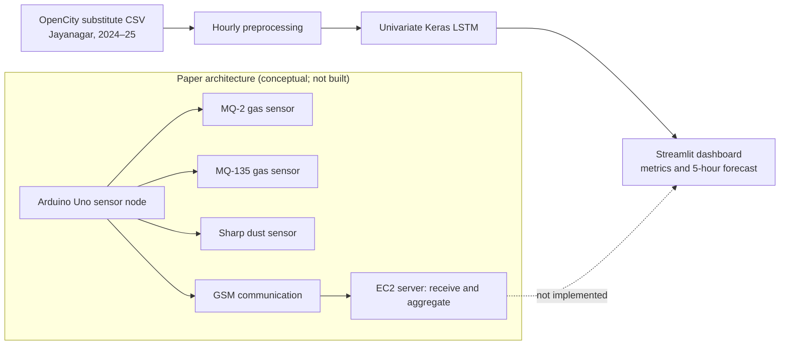

# Air quality forecasting with LSTM

A runnable, paper-informed reproduction of the core hourly forecasting methodology in Sagar V. Belavadi et al., “Air Quality Forecasting using LSTM RNN and Wireless Sensor Networks,” *Procedia Computer Science* 170 (2020), 241–248, DOI [10.1016/j.procs.2020.03.036](https://doi.org/10.1016/j.procs.2020.03.036).

## Important data disclosure

The included dataset is a substitute: hourly aggregates from Jayanagar 5th Block, Bengaluru, 2024–25. It is **not** the paper’s experimental data, which included 2019 Amaravati APPCB observations and Bengaluru observations from the authors’ WSN/government sources. Results cannot reproduce the paper's published numbers. The original downloaded CSV is kept at `data/raw/blr-jayanagar-5th-block-kspcb-2024-25.csv`; preprocessing never overwrites it. If absent, the app attempts to download the public CSV and shows an actionable error on failure.

## Run on Windows / VS Code

From the project directory in PowerShell:

```powershell
py -m venv .venv
.\.venv\Scripts\Activate.ps1
python -m pip install --upgrade pip
python -m pip install -r requirements.txt
python -m pip install -e .
python -m pytest
python -m streamlit run app.py
```

TensorFlow wheels are Python-version/platform dependent; use a 64-bit Python 3.11–3.13 installation. If PowerShell blocks activation, run `Set-ExecutionPolicy -Scope Process Bypass` in that terminal and activate again.

The dashboard has two separate sources: the original substitute CSV, and **Recent CAMS estimates (near Jayanagar)** for a current-date forecast. Current mode fetches up to 92 days from the Open-Meteo Air Quality API, uses completed hourly history only, and makes a five-hour recursive forecast beyond the latest returned hour. It is gridded model output, **not a ground-station or hardware sensor observation**. API access is subject to availability; no API key is needed for ordinary non-commercial use. Timestamps are UTC, and estimates may be spatially coarse. The dashboard caches the response for 30 minutes and has a refresh button. Attribute [Open-Meteo Air Quality API](https://open-meteo.com/en/docs/air-quality-api) and [Copernicus CAMS](https://atmosphere.copernicus.eu/). This mode is distinct from the historical 2024–25 CSV and never mixes the sources.

The dashboard downloads the historical source if it is missing. To download it separately:

```powershell
python -c "from air_quality_forecasting.data import download_dataset; print(download_dataset())"
```

## Method

1. Parse timestamps, sort observations, deduplicate timestamp rows, convert measurements to numeric, and average numeric pollutant measurements per hour.
2. Mark source pollutant measurements with absolute Z-score greater than 3 missing before hourly aggregation.
3. Fill missing hourly pollutant values from the value 168 hours earlier; where unavailable, use that series' mean.
4. Fit one univariate model per selected pollutant. Weather fields are deliberately excluded, consistent with the paper's statement that weather is not directly incorporated in its forecasting model.
5. Use 24 previous hourly values (an explicit assumption because the paper does not report sequence length). MinMax scaling is fit on the training segment only.
6. Split in time order: first 67% training, final 33% test. Train the paper's LSTM(64, ReLU, sequences), LSTM(32, ReLU), Dense(1, linear) with Adam/MSE for up to 50 epochs. Early stopping monitors a tail validation slice from training data and restores best weights.
7. Inverse-transform predictions, report test RMSE and `100 × RMSE / max(actual test)`, then recursively forecast five hours.

## Wireless sensor network scope

The diagram below describes the paper's conceptual data path. Only offline CSV processing, LSTM forecasting and a local dashboard are implemented. No hardware, cloud service or sensor communication is simulated as if it were real.



Arduino Uno nodes, MQ-2, MQ-135, Sharp dust sensors, GSM communication, the EC2 listener/API, on-premises model training/deployment and the paper's original data feeds are not reproduced. This project makes no claims about physical sensor accuracy or WSN operation.

## Structure

```text
app.py
src/air_quality_forecasting/{data,preprocessing,model,forecast,metrics}.py
tests/test_core.py
reports/methodology.md
data/raw/...
```

See [`reports/methodology.md`](reports/methodology.md) for step-by-step comparison and deviations. Tests cover weekly imputation, chronological split boundaries, recursive forecasts and evaluation metrics.

